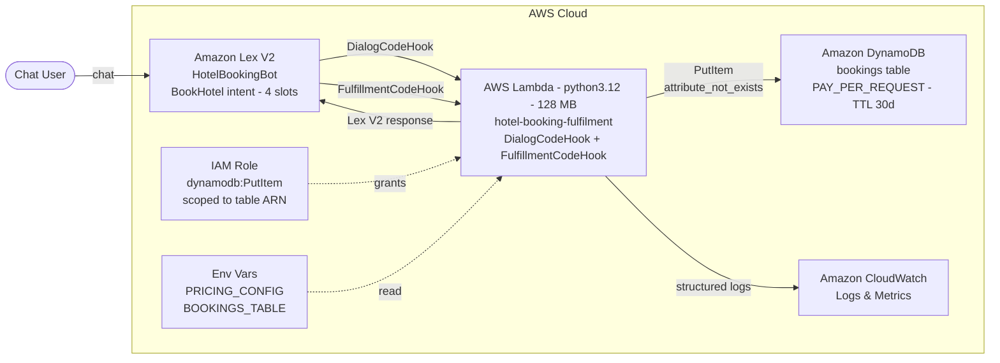

# Hotel Booking Chatbot — Amazon Lex V2 + AWS Lambda

A conversational hotel booking chatbot built on **Amazon Lex V2** with
**AWS Lambda fulfillment** written in Python. The bot collects four slots
(location, check-in date, nights, room type), validates them, calculates
an **estimated total price** using a configurable pricing table, and
returns a formatted summary to the user.

> **Important:** This project demonstrates a conversational booking
> workflow. It calculates a **simulated estimate** and returns a summary
> message. It does **not** make real hotel reservations, process payments,
> or hold room inventory.

---

## Project status

| Capability | Status |
|---|---|
| Lex V2 `BookHotel` intent and slot design | Implemented |
| Natural-language slot collection | Implemented |
| Lambda fulfillment code | Implemented (`src/`) |
| Dynamic pricing from configuration | Implemented |
| Application-level slot validation | Implemented |
| Unit + integration-style tests | Implemented (122 tests) |
| SAM template for deployment | Implemented (`template.yaml`) |
| DynamoDB persistence | Implemented (idempotent writes, TTL 30 days) |
| GitHub Actions CI | Implemented (`.github/workflows/ci.yml`) |
| Real hotel reservation / inventory | Not implemented — simulated only |
| Payment processing | Not implemented |
| Database persistence | Not implemented |
| Web widget | Not implemented |

---

## Architecture

The Lambda function is **pure Python**. Its only AWS SDK call is a
scoped `dynamodb:PutItem`; it does not call any other AWS service at
runtime.

Flow:

1. User sends an utterance to `HotelBookingBot` (Amazon Lex V2).
2. Lex invokes the Lambda twice per booking:
   - `DialogCodeHook` — validates slots as they are filled.
   - `FulfillmentCodeHook` — final validation + price estimate.
3. The Lambda reads `PRICING_CONFIG` once per invocation.
4. On successful fulfillment it writes one record to DynamoDB
   (idempotent via a sha256 `bookingId` and an
   `attribute_not_exists(bookingId)` condition).
5. It returns a structured Lex V2 response. Logs go to CloudWatch;
   the `Location` value is stored in DDB but only its length is
   logged, so free-text PII does not land in logs.

---

## Persistence

Every successful fulfillment writes one immutable record to DynamoDB
before returning a Lex response. Fields:

| Field | Type | Notes |
|---|---|---|
| `bookingId` (PK) | S | sha256(sessionId\|location\|checkInDate\|nights\|room), 32 hex chars |
| `sessionId` | S | Lex session ID |
| `location` | S | Free-text from slot (PII-safe: not logged) |
| `checkInDate` | S | ISO date `YYYY-MM-DD` |
| `nights` | N | Integer 1..maxNights |
| `roomType` | S | Lowercase room key |
| `subtotal`, `tax`, `total` | S | Decimal-as-string to avoid float drift |
| `currency` | S | e.g. `INR` |
| `status` | S | Always `SIMULATED` |
| `createdAt` | S | ISO timestamp (UTC) |
| `expiresAt` | N | Unix epoch, TTL 30 days |

**Idempotency.** Same session + same inputs => same `bookingId` =>
`ConditionalCheckFailedException` on retry => no-op, no duplicate.
**TTL.** `expiresAt` lets DynamoDB delete old records for free.
**No GSIs.** Queries by date or room would need them; none are needed yet.

See `docs/data-model.md` for the full schema and cost analysis.

---

## Design decisions

- **Two-phase validation:** `DialogCodeHook` validates only filled
  slots, so Lex can still prompt for missing ones.
  `FulfillmentCodeHook` re-validates everything before pricing.
- **Decimal money math:** `Decimal` + `ROUND_HALF_UP` + quantize to
  `0.01`. No floats anywhere.
- **Config externalized:** all prices in `PRICING_CONFIG`, no magic
  numbers in code.
- **No AWS SDK:** handler uses only the Python standard library.
- **Failure isolation:** unhandled exceptions become a Lex `Close`
  with `Failed` state and a generic user message; the traceback goes
  to CloudWatch. Internal detail never reaches the user.
- **Simulated only:** confirmation message explicitly says no real
  reservation was made.

## Known limitations

- No persistence — sessions are held only by Lex.
- No availability check — any room/date returns an estimate.
- No payment.
- `en_US` only.
- Only the `BookHotel` intent is handled by this Lambda.

---

## Repository layout

| Path | Purpose |
|---|---|
| `src/` | Lambda handler and helper modules |
| `tests/` | pytest suite + `events/` JSON fixtures |
| `demo/` | original demo video (unchanged) |
| `screenshots/` | original screenshots (unchanged) |
| `docs/` | architecture + Lex config docs |
| `template.yaml` | AWS SAM template |
| `samconfig.toml.example` | SAM config example |
| `Makefile`, `pyproject.toml` | local dev tooling |

---

## Pricing configuration

Prices live in the `PRICING_CONFIG` environment variable (JSON).

| Room | Display name | Price / night (INR) |
|---|---|---|
| `classic` | Classic | 2000 |
| `deluxe` | Deluxe | 3000 |
| `duplex` | Duplex | 5000 |
| `suite` | Suite | 7000 |

Defaults: `currency=INR`, `maxNights=30`, `taxRatePercent=0`.

Invalid JSON raises `ValueError`; the handler catches it and returns a
generic failure message, logging the traceback to CloudWatch.

None of the above is secret. Future secrets belong in AWS Secrets
Manager or SSM Parameter Store — never in `PRICING_CONFIG`.

---

## Local testing

Run the full suite (113 tests) and linter:

    python3 -m venv .venv
    source .venv/bin/activate
    make install
    make test
    make lint

Run handler tests verbosely:

    PYTHONPATH=src pytest tests/test_lambda_handler.py -v

Invoke the handler locally against a fixture (see smoke example in
`tests/test_lambda_handler.py::test_fixture_fulfillment_valid_returns_fulfilled_estimate`).

---

## Deploying

Prerequisites:

- AWS SAM CLI installed
- AWS credentials with IAM, Lambda, and Lambda-permission create access
- A Lex V2 bot with a `BookHotel` intent already exists
  (see `docs/lex-configuration.md`)

Steps:

    cp samconfig.toml.example samconfig.toml
    # edit samconfig.toml: set region and LexBotAliasArn
    sam validate --lint
    sam build
    sam deploy --guided

Then associate the deployed function with the `BookHotel` intent in the
Lex V2 console as both the Dialog code hook and the Fulfillment code
hook.

### Verification status

- `sam validate --lint` and `sam build` pass locally.
- 122 tests pass; `ruff check src tests` is clean.
- **Not yet deployed to AWS.** Deployment requires an AWS account and
  a Lex V2 bot alias; run `sam deploy --guided` as described above to
  provision the Lambda, DynamoDB table, and IAM permission, then wire
  the function to the `BookHotel` intent in the Lex console.

Cost: Lambda 128 MB / ~10 ms per call is well within free tier.
DynamoDB on-demand with TTL is effectively $0 at demo traffic
(25 WCU / 25 RCU free tier covers far more than this traffic produces).
Lex V2 charges depend on text vs. speech usage. No pay-per-hour
resources are created.

Cleanup:

    sam delete --stack-name hotel-booking-chatbot

---

## Screenshots and demo

`demo/` and `screenshots/` contain the **original** demo video and
screenshots of the earlier Lex-only implementation (static fulfillment
response, no Lambda).

The new Lambda path is implemented and tested locally, but its runtime
appearance may differ. No new screenshots exist yet for the Lambda path.
If you deploy and verify it in your account, add new screenshots under
`screenshots/lambda/` rather than overwriting the originals.

## License

See [LICENSE](LICENSE).
